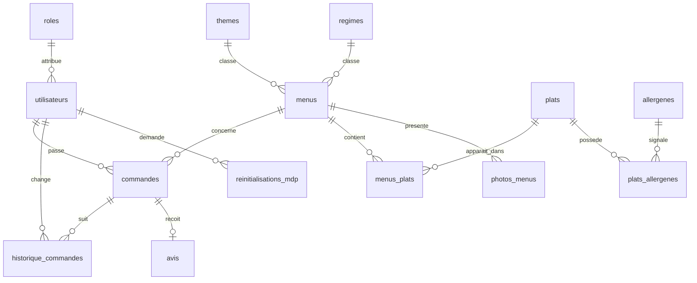

# Base de données - Vite & Gourmand

Cette première partie du back-end prépare les tables nécessaires au site. Elle utilise **MariaDB / MySQL**, comme dans le cours Studi sur la création d'une base de données SQL.

## Les fichiers

- `01_creation.sql` crée la base de données `vite_et_gourmand` et ses tables.
- `02_donnees.sql` ajoute les deux menus du site, leurs plats, leurs photos, les allergènes, les horaires et les rôles.

Il n'y a pas de vrai compte utilisateur dans les données de départ. Le compte administrateur sera créé plus tard avec un mot de passe protégé par PHP.

## Importer dans XAMPP

1. Ouvrir **XAMPP**, puis démarrer **Apache** et **MySQL**.
2. Ouvrir `http://localhost/phpmyadmin` dans le navigateur.
3. Choisir **Importer**, sélectionner `01_creation.sql`, puis cliquer sur **Importer**.
4. Cliquer sur la base `vite_et_gourmand`, puis importer `02_donnees.sql`.
5. Ouvrir l'onglet **SQL** et saisir cette requête pour vérifier les menus :

```sql
SELECT id, titre, personnes_minimum, prix_minimum
FROM menus;
```

Il faut obtenir **Menu Classique** (10 personnes, 250 €) et **Menu Végétarien** (8 personnes, 200 €).

**Attention :** importer ces fichiers une seule fois sur une base neuve. Les réimporter tels quels provoquera des erreurs de doublons. Ne pas supprimer une base qui contient déjà des commandes réelles.

## Comment les tables sont liées



Chaque table contient des lignes. La colonne `id` permet d'identifier une ligne, et les colonnes comme `menu_id` ou `utilisateur_id` servent à relier les tables.

Par exemple :

- **Un utilisateur** peut passer plusieurs commandes, mais chaque commande appartient à un seul utilisateur.
- **Un plat** peut être utilisé dans plusieurs menus. C'est pour cela qu'on a la table `menus_plats`.
- **Une commande** garde un historique avec la date et l'heure de chaque changement de statut.
- **Un avis** est lié à une commande ; le PHP vérifiera que celle-ci est terminée avant de permettre de publier l'avis.

Les prix sont enregistrés avec `DECIMAL(10,2)` pour avoir des montants précis en euros. Le mot de passe sera enregistré sous une forme hachée, jamais en clair.

## Et après ?

La base relationnelle est seulement le début. Il reste à connecter les formulaires avec **PHP et PDO**, à créer une vraie connexion sécurisée et à contrôler les permissions. Il faudra aussi ajouter **MongoDB** pour les statistiques de l'administrateur, puis tester et déployer le site.

Les données de test présentes actuellement dans `localStorage` ne sont pas encore reliées à cette base SQL.
